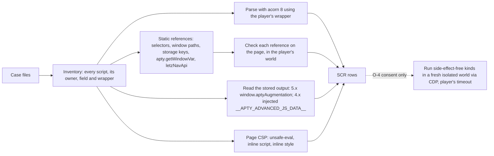

# SE debugging flow: final design

Status: **final design, confirmed with the owner**. This document is the
single source of truth. It supersedes these earlier documents wherever
they differ, though their detail and citations still hold:

- `se-flow-architecture.md`, §1–§10;
- `replay-network-source.md`;
- `se-flow-coverage.md`, which remains the full condition inventory.

The build brief is `docs/tasks/se-flow/IMPLEMENTATION-PROMPT.md`.

All work happens in **apty-super-hero**. **apty-dap** (5.x) and
**apty-assist** (4.x) are read only and are never changed. Every claim
about Apty cites `repo:path:line` at:

- apty-dap `3f3adba`, with paths under `packages/`;
- apty-assist `bbb4cbc`, with paths under `player3.0/src/`.

## 1. What the SE experiences

1. The SE opens the Agent on the customer page and says **what is wrong**.
   For example: "workflow 'Create a lead' does not start".
2. If the Agent cannot read Apty from the page, it asks once, in one card,
   for **the tenant, application and environment**. It also asks for the
   user's identifier, but only when a user-specific check needs it and the
   page does not show it.
3. A **live checklist** fills in. Each row is a step the Agent took, with
   its status and its source.
4. **One result** follows: "Issues found, please fix all of these". Each
   issue gives the cause, the evidence and the fix. It also shows Ask
   Dapty's guidance (labelled) or the KB card as written, with
   **Re-check** and **Copy for support**.
5. If nothing was found, there was no KB answer and no card applies, the
   Agent offers one button, **Ask AI anyway**. It shows a cited AI answer,
   or "Not enough evidence".

The rest of the debugging is the Agent's work. There is no script in the
Apty widget, no Client extension ID, and no action from Apty per case.

## 2. Principles

| Principle | Meaning |
|---|---|
| Read-only toward Apty | The Agent changes no Apty code and makes only the player's own public GETs. Ask Dapty's public chat is the one POST. Nothing is sent with cookies, and no admin, Studio or authenticated API is called |
| No Client dependency | The Agent never messages the Apty Client. The Client record exists only behind the `aptyClientRecord: optional` org setting, which is off by default |
| Evidence or nothing | A cause is shown only when a check proves it from a file, field, element or value. Anything the Agent cannot decide is "?", with the exact value that would decide it |
| Mirror the player | The Agent uses the same files, paths, version stamp, URL matching, rule logic and drop rules as the player. Each rule cites the Apty line it mirrors and records `verifiedOn` |
| Privacy first | The body deny list is checked before any request. Bodies get the Client record's redaction, stay in memory for the case only, and are never written to disk. Hosts come only from the page's Apty config or the org policy. The SE's question is redacted before it goes to Ask Dapty |
| Only necessary requests | §6 |

## 3. Architecture

```
@apty/agent-core      pure: interfaces and decisions
  apty/content-source        AptyContentSource + named failures                 (built)
  apty/versions              4.x / 5.x adapters: ID shapes, paths, stamps, URL matching
  apty/schema-mirror         the player's per-item and whole-file drop rules
  apty/rules                 5.x rule evaluator; 4.x segment evaluator
  apty/coverage              condition IDs, symptom → check groups, rule registry
  case-run                   ChecklistRow, CaseRunEvent, CaseRunResult, aggregate()
  ask-dapty                  DaptyAnswer, classify()
  answer                     provider chain, FallbackReason, qualityCheck()
  agent/types                LocalAnswer.progress, AgentEvent "tool_call_progress"
  config/org-policy          aptyContentOrigins (built), askDapty, modelA, aptyClientRecord

@apty/browser-runtime  Chrome
  apty/replay                file catalogue, fetch pipeline, per-case cache     (built)
  apty/probes                4.x / 5.x page probes, MAIN-world page-input reader, user file
  apty/diagnosis             check packs (existing + new groups), router → many routes
  apty/case-run              orchestrator: context → {Ask Dapty ∥ checks} → cards → result
  apty/ask-dapty             SSE client, one-shot fallback, redaction
  answer                     Model A → Model B runner
  tools                      resolve_apty_context, list_apty_files, fetch_apty_file (built)

@apty/ui               depends on agent-core only
  checklist, result card, intake card, guidance panel, AI answer, Not enough evidence

apps/browser-extension wiring, Options (policy status), first run, manifest/managed schema
```

### 3.1 Components and trust

```
SE's browser                                          outside
┌───────────────────────────────────────────┐
│ Customer tab ◄─probe── Agent (side panel) │──GET, no cookies──► Apty content host
│ (page, player)        · chat, checklist   │──POST SSE─────────► Apty ai-service (Ask Dapty, KB tenant)
│                       · case run          │──Ask AI anyway────► Model A (org OpenAI/Azure)
│ Apty Client ext. ✕ never contacted        │──fallback─────────► Model B (Anthropic)
│ Org policy ──► hosts · KB tenant · keys   │
└───────────────────────────────────────────┘
```

The case run, its requests and the Ask Dapty stream run in the side panel,
an extension page with host permission, so CORS does not apply. Requests
are aborted when the conversation closes. The MCP-bridge path runs the
same orchestrator in the service worker.

## 4. Flows

### 4.1 Application flow

```
question
 ├─ bare how-to? ──yes──► context (from the page or the SE; no content request)
 │                         → Ask Dapty (that version's KB application)
 │                         → guidance; [Run checks]; Ask AI anyway only if Ask Dapty gave up/errored
 └─ symptom
     → 0 context: given IDs (pinned) | page probe + URL match | ask the SE (one card, only what's missing)
     → in parallel:
         1 Ask Dapty (stream)                  2 every check group the symptom needs
                                                 (replayed files + page + own rule evaluation;
                                                  live checklist rows)
     → 2b cards: only if Ask Dapty gave up, errored, or may have answered from the web
     → 3 ONE result: issues (cause · evidence · fix · source) + guidance or card
          + [Re-check] [Copy for support]
     → 4 no issue, no KB answer, no card → [Ask AI anyway]
          → Model A (org key, gpt-6-luna) → quality check → pass: "AI answer · gpt-6-luna"
          → error or fail → Model B (Anthropic) → quality check → pass: "AI answer · Anthropic"
          → fail → "Not enough evidence": claims to check, next check, Copy for support
```

### 4.2 Why the checks run in parallel with Ask Dapty

- **The checks do not use Ask Dapty's answer.** The symptom router picks
  the checks from the SE's message. Ask Dapty's text is guidance only and
  can never be a cause.
- **Speed.** Ask Dapty streams over several seconds (20 s timeout). The
  checks take about 1–4 s on cached files. Rows appear within about a
  second, and the result shows when the slower of the two finishes.
- **Resilience.** An Ask Dapty error, timeout, give-up or missing setup
  never blocks the root cause.
- **Accuracy.** Letting Ask Dapty skip or narrow the checks would let an
  unverifiable answer (it gives no sources, and a web answer cannot be
  detected) suppress evidence.
- **Only the cards wait for Ask Dapty**, so a KB answer and a card never
  compete.

### 4.3 How-to questions make no content requests

`isBareHowTo` (`packages/browser-runtime/src/kb/kb-intent.ts:62-74`)
matches how-to wording ("how do I", "how to", "can I", "where is the
setting for") with no symptom word. `hasSymptomWord` (`:54-60`) checks
for words such as "not", "missing", "nothing happens".

- **The route:** context, then Ask Dapty, then the guidance.
- **No cards:** KB cards answer symptoms, not how-tos (owner decision
  D-KB1).
- **Ask AI anyway** only if Ask Dapty gives up or errors.
- **A "Run checks" button** starts the symptom checks if there is in fact
  a problem.
- **Symptom wording always runs the checks.** "How do I fix the tooltip
  that doesn't show?" counts as a symptom.

### 4.4 Finding the Apty context

1. **IDs the SE gives win.** With all three IDs, no request is needed. A
   tenant different from the page's needs a confirm step.
2. Otherwise the **page probe**:

   | Version and mode | Where the Agent looks |
   |---|---|
   | 5.x Extension | `window-script.js`, then `player-config.json` |
   | 5.x Injected | `window.__APTY_PLAYER_CONFIG__` |
   | 4.x Extension | `window.var.js`, then `config.json`, keeping only `contentURL`, `tenantKey`, `regExpUrlFlag` and `isSelfHosted` |
   | 4.x Injected | the `#letznav-script` attributes |

3. Then **match the page URL** in `app-urls.json`, using the version's
   rules (§7).
4. Not found, or no match, means **ask the SE**. Note that a 4.x Client on
   a page with no matching application never adds `window.var.js`
   (`main.bootstrap.ts:162-170`), so the Agent must ask there.
5. The version comes, in order, from: what the SE said, the probe, the
   shape of the IDs (UUIDs mean 5.x; a short key plus numbers mean 4.x),
   or a question to the SE.
6. The context is **pinned for the case**.
7. An optional **ask-first mode** (decision D-ASKFIRST) always confirms
   the IDs in the intake card before the first request.

### 4.5 Inside one question

1. The UI sends the question to the agent loop. Its local responder is
   the case run, which emits `tool_call_start` right away.
2. The case run resolves the context through replay.
3. It starts the Ask Dapty stream and runs the matching check groups.
4. Each group reads its files from replay (one fetch per file per case).
   Each gate becomes a row, and each row is a progress item that the agent
   loop emits as `tool_call_progress`.
5. Then the classified Ask Dapty answer, and the cards if needed.
6. Then the result, emitted as `tool_call_complete`.
7. The case record and the transcript keep only the final result.

### 4.6 Fetching one file (built)

1. **Catalogue path.** A file outside the player's list, or an ID that is
   not a plain segment, fails as `unknown_file` or `ids_missing`.
2. **Host allowed.** Otherwise `host_not_allowed`. Page-named
   private-network and IPv6 hosts are refused.
3. **Deny list,** checked before the request: `body_denied`.
4. **The player's version stamp,** from `content-config.json`.
5. **GET** with no cookies, no redirects and a 10 s timeout. Failures are
   `network`, `timeout` or `http_<code>`.
6. **CloudFront's 200 not-found page** means `not_published`.
7. **Redaction**, or `too_large`.
8. **JSON and schema:** `unparsable` or `schema_mismatch`.
9. **The case cache,** with conditional requests on Re-check. Concurrent
   requests for the same file share one fetch.
10. **The checks' loader.**

### 4.7 Reading Ask Dapty's answer

- **The request:** `POST {aiBackendURL}/ai-service/api/v1/ai/{kbTenantId}/widget/chat/stream?applicationId={KB app for the case's version}`.
  - The body is `{message: redacted, context: [], envId, applicationType}`,
    with no `userId` and no `chatId`.
  - If the stream does not open, fall back once to the one-shot route.
- **The classes:**

  | Class | When | Result |
  |---|---|---|
  | `kb_answer` | A `knowledge_retrieve` round was seen, plus citations or no outside URL | Guidance, labelled "KB" |
  | `gave_up` | The exact or near give-up text (`ai-chat-widget.service.ts:23-24`) | The cards run |
  | `web_or_unknown` | Anything else; this is a heuristic | Guidance labelled "may include web results", and the cards run |
  | `error` | An error, a timeout or 4xx/5xx | The cards run |

### 4.8 Ask AI anyway

- **When:** offered only when the result is "clear" or "no data", Ask
  Dapty gave up, errored or is not set up, and no card covers the
  question.
- **The models:**
  - **Model A:** the org's OpenAI or Azure key, model `gpt-6-luna` (the
    default OpenAI model in ai-service, `llm.constants.ts:3-7`). It is
    used only when configured and allowed by the destination policy.
  - **Model B:** Anthropic, the Agent's own model.
  - **Moving to the next model:** after the same-provider retries, on a
    400/404 model error, 401, 403, exhausted retries, a timeout or a
    failed quality check.
- **What the model gets:**
  - every checklist row, masked;
  - the causes;
  - Ask Dapty's text, marked as guidance;
  - the cards, only if `kbToModel` is `approved`;
  - read-only tools.
- **The quality check** needs no model. Every Apty claim cites
  `kb://card#L`, `check://ruleId` or `code://repo:path:line`, and it
  checks four things:
  1. the citation resolves;
  2. grounding holds;
  3. no claim contradicts a decided row;
  4. the claim is not cited only from the other version's cards.

## 5. The checklist and the result

**Row:**

```
{id, group, label, status: pass | fail | unknown | info,
 source: page | agent | client | capture | dapty | cards | not-checked,
 evidence?, ruleId?, cardPageId?, reason?, version}
```

- Rows are grouped in order: Context, Load, Knowledge, Item, Audience,
  Rules, Element, User history, Not checked.
- They are de-duplicated by `id`, and a later status replaces an earlier
  one.

**Accessibility:**

- the list has `role="list"`;
- only the summary line is announced (`aria-live="polite"`, "4 of 9
  checks done, 1 issue");
- every control works from the keyboard;
- respect `prefers-reduced-motion`;
- light and dark themes both work.

**The result card:**

- **Header:** "Issues found, please fix all of these", "No issue found in
  Apty's data", "Could not read Apty's data", or "Possible causes to
  check".
- **Each issue:** what is wrong, the evidence (masked), how to fix it
  (naming the Studio setting), the source, the KB card link, the rule
  tag, and "Was this right?".
- **Then:** "Not checked", followed by the guidance panel.
- **Buttons:** Re-check, Copy for support, and Ask AI anyway when it is
  allowed.

**Empty and error states:**

- no Apty on the page and no IDs given;
- the policy blocks the host;
- offline;
- Ask Dapty not set up: an info row, not an error.

## 6. Network-call policy

### 6.1 When requests happen

| Situation | Content-file requests | Ask Dapty |
|---|---|---|
| Bare how-to | **None** | 1 |
| All three IDs given | No `app-urls.json` lookup | — |
| Only some IDs, or IDs read from the page | `app-urls.json` once | — |
| A symptom (e.g. 5.x tooltip) | Only the files that symptom's checks read, typically 6–8. The player itself loads about 25 per page | 1, in parallel |
| A user-specific check | `users/{id}.json`, only when such a check runs and the ID is known | — |
| Element, page, rule and segment checks | **None**; local page reads | — |
| Another question in the same case | **None**; the case cache answers | Only if the question changed |
| Re-check | One conditional request per file (304 when unchanged) | Only if the question changed |

### 6.2 What prevents unnecessary requests

| Protection | State |
|---|---|
| The symptom decides the file set | Design (WP6) |
| One cache per case, including `not_published` answers | Built |
| Concurrent requests for the same file share one fetch | Built (`inFlight`) |
| Conditional requests on Re-check | Built |
| Only catalogue paths, only allowed hosts | Built |
| At most 6 concurrent requests and 40 per case; 5 MB per file (built) and 25 MB per case | Design (WP10, WP14) |
| Page reads batched into one `executeScript` per frame per case | Design |
| No AI model call on the check path | Design; asserted in every E2E |

### 6.3 Requests made on purpose (owner may change)

1. **`content-config.json` before the first file.** One request, cached.
   It gives the player's version stamp, so the Agent reads the same copy
   the player gets. **Keep.**
2. **Ask Dapty in parallel, even when the checks find the cause.** One
   POST. It buys speed and KB guidance beside the fix. The alternative is
   to call it only when the checks find nothing (decision D-DAPTY-WHEN).
3. **Re-check asks again**, with conditional requests.

## 7. Both versions

| Step | 5.x (apty-dap) | 4.x (apty-assist) |
|---|---|---|
| Probe | `window-script.js` → `player-config.json`; `__APTY_PLAYER_CONFIG__` | `window.var.js` → `config.json` (`manifest.json:17-21`); `#letznav-script` (`injected.helpers.ts:344-375`) |
| IDs | UUIDs | Short tenant key, numeric app, numbered envs |
| Environment match | First app with a match. Envs by `order`, wildcard, unanchored; regex never (`active-application.helpers.ts:3-45`; `cdn.service.ts:937-939`) | Apps in order. Env keys `.map(Number).sort()`, which sorts **as strings**. Wildcard, or raw RegExp when `feature-flag.json` `regExpUrl` is on. Env 1 by default (`app.helper.ts:81-109`) |
| Content URL | From the page config | From the page config; for self-hosted, `{hostedContentUrl}/contents` if the policy allows (`main.bootstrap.ts:138-150`) |
| Version stamp | Walks the tenant content-config (`file-timestamp.ts:4-27`) | Merged tenant and app content-config: `cc[app][env][file] \|\| latest \|\| now` (`content-config.helper.ts:5-29`) |
| URL suffix | `?timestamp=` | `?timestamp=…&token=` (`common-helpers.ts:90-95`) |
| Widget display | **Per environment:** `widgetDisplayConfig`; missing means hidden (`segments.service.ts:64-80`, since `9b2eef11`) | `widgetConfig.display` All/Specific/None plus `enabledForOtherUser` (`app.selectors.ts:128-152`) |
| Auto-trigger | `stepsAutoTrigger[]` only (`workflow.mapper.ts:89-93`) | `stepsAttachedRules[]` AutoTrigger. Daily, weekly and monthly never repeat (`rule-engine.effects.ts:298`) |
| Rules | The Agent evaluates them (§8.1) | Segments are evaluated. Rule trees and element selection need decision O-3 |
| Ask Dapty in the player | Yes | None |
| Ask Dapty KB | One ai-service. The KB tenant has one application per version, plus tenant-wide common documents (`vector-store.service.ts:175-185`) | Same |

## 8. Coverage of every case

`se-flow-coverage.md` lists every condition both players check: about 70
for 5.x and 80 for 4.x, each with `repo:path:line`. Each one becomes a
checklist row decided from:

- **F**: the files;
- **U**: the user file;
- **P**: the page;
- **E**: the Agent's own rule evaluation;
- **R**: runtime-only, shown as "?" with the value that would decide it.

**Symptoms and their check groups:**

| Symptom | Groups |
|---|---|
| Widget not visible | Load, Widget |
| Item missing from the list | + Item, Audience, Rules, List |
| Workflow does not start by itself | + Auto-trigger, User history |
| Workflow does not open | + Launch, Steps file |
| Step stuck, broken, ends early | Steps file, Step play, Element |
| Tooltip, Launcher, Validation, Announcement, Checklist, Knowledge content | Their own groups, plus Audience and Rules (and for Announcement and Checklist, User history) |
| Wrong language | Locale, Item texts |
| Onboarding (4.x) | Onboarding |
| Ask Dapty | The existing check, plus Item and Launch |
| Logs | The existing check |
| Page readiness | The existing check |
| A customer script does not work | Scripts (§8.3), Platform |
| Progress, favourites or "don't show again" forgotten | User history, Platform |
| Reminder missing or early (5.x) | User history, Platform |
| Permalink does nothing | Item, Platform |

Every symptom also runs the Platform group's cheap rows (§8.4): they
reuse files and page reads already made, so they add no requests.

### 8.1 The Agent's own evaluation engines

**The 5.x rule and segment evaluator** is pure code in agent-core, kept
identical to the player by parity tests.

- **Grammar:** groups of `AND` or `OR`, with no `NOT`.
- **Operators:** `eq` is strict. A missing value makes `neq`,
  `notContains` and `notIn` true. Strings are tried as dates first (V8).
  An invalid `regex` fails the whole pass.
- **Segment active** = `isActive && rule === true`. An item's segments
  are combined with OR, and inactive memberships count.
- **Sources:** page, `window` (properties only, decision D-WIN), storage,
  `document.cookie`, date, device (decision D-UA), `aptyAugmentation`,
  elements (when the match is unambiguous), and the user file.
- **`customScript`:** checked statically (§8.3); its value is "?" unless
  decision O-4. **`lastActivityTime`** is always "?" (it lives in the
  Client's storage).
- **World parity:** each value is read in the world the player reads it
  from (§8.3).

**4.x segments:**

- `conditions[][]`: OR over groups, AND within a group.
- **An absent key is false for every relation** (`segment-executor.helpers.ts:166-168`).
- The `segment-js` keys: in injected mode, read the last result the
  player stored (`window.__APTY_ADVANCED_JS_DATA__` in the Apty frame)
  without running anything. In extension mode that value lives in Apty's
  isolated world, which the Agent cannot read, so the keys are "?" unless
  decision O-4.

**Schema-drop mirrors** cover each file's per-item and whole-file
validation. Examples:

- a visibility rule pair that is only half set;
- one blank tooltip translation drops the tooltip in every language;
- one invalid step blocks the whole workflow.

### 8.2 Apty behaviour the Agent names as causes (from code)

**5.x:**

- display per environment, where missing means hidden;
- the blank-translation tooltip drop;
- inactive-only segment membership hides the item;
- `visibilityRuleAction`, `enableWidget` and `enabledForOtherUser` have
  no effect;
- a gap in the step order ends the run early;
- one invalid row in `app-urls.json` blocks every page;
- `scheduleRange` is not enforced;
- knowledge content `hideFromWidget` defaults to true;
- tags are not searchable.

**4.x:**

- auto-trigger never repeats;
- an unknown permalink fails silently;
- with `publishingSystem` off, no flows are listed;
- a missing `baseTag` or empty `app-data.json` means no widget;
- env keys sort as strings;
- a scheduled tooltip with an empty time zone is hidden;
- launcher text with no locale fallback;
- an absent segment key is false.

### 8.3 Customer scripts (both versions)

Customer scripts fail silently: 5.x logs a warning or a debug line, and
4.x `letzConsole` prints nothing in production
(`apty-assist: player3.0/src/shared/helpers/letzconsole.ts:1-5`). The
Agent checks every script **without running it**:



| Kind | 5.x | 4.x |
|---|---|---|
| Application load | `application-script.json` APPLICATION_LOAD: isolated world; top frame with `apty`, iframes without; once, after init | `custom-js.js`: Sval, once per frame |
| Segment / augmentation | DOM_CHANGE: every rule pass, 5 s cap each, results merged into MAIN `window.aptyAugmentation`; a failure keeps old keys | `segment-js.js`: extension runs `new Function` in the **page** (needs `unsafe-eval`, inline fallback); injected uses Sval. **No reply freezes the whole UI** (D-01) |
| Rule script | isolated world, no `apty`, every frame, OR'ed | `customScriptPool`: `!!result`, so async is always true |
| Element lookup | sync; must return an element | Sval (extension) or page `Function` (injected, needs `unsafe-eval`) |
| Click actions | launcher, CTA, Layout, announcement: with `apty`; announcement completes even if the script fails | — |
| Step script, decision point | — | `letzNavApi.flow.*`; decision points 2 s, then the next step |
| Validator | sync `function(field)`; a Promise means always valid | outside the try: a syntax error freezes validation silently |
| DOM config | `domConfig.*Function`: a syntax error breaks **every** element lookup | — |
| Styles, smart canvas | — | custom-css into every frame (CSP, sanitizer); smart-canvas buttons need exact data attributes |

Scripts are parsed with **acorn 8.16.0, the parser Sval 0.6.11 uses**
(`apty-dap: pnpm-lock.yaml:32672-32674`), so a parse error the Agent
reports is the error the 5.x player hits. 4.x uses Sval 0.4.8
(`player3.0/package.json:53`); its parser version is NOT VERIFIED, so a
4.x parse error on syntax newer than ES2018 is a "candidate".

**World parity.** 5.x rule `window` values are read in MAIN (the
player's window-script), but a 5.x rule script or APPLICATION_LOAD script
runs in the isolated world and sees no page globals. 4.x extension
`WINDOW_VARIABLE` segments read `window.top[k]` from the content script
(`localstorage.helper.ts:33-49`), so the Agent reads them in an isolated
world too, and shows both values when they differ.

### 8.4 Platform, extension and flags

These rows can block every item, so they run for every symptom:

- **5.x:** player below 5.2.2 drops whole files with `EVERY_TIME` or
  `CUSTOM_SCRIPT`; the external ID silently falls back to the Apty ID
  (per app and env); user-file writes fail silently and a failed read
  makes the next write erase progress; files are cached for the page's
  lifetime; self-hosted moves preferences to browser storage; host
  permissions cover only `*.apty.ai`; window-script death; extension site
  access and duplicate builds; dev mode (`apty_player_dev_mode`) shows
  the User ID, segments and true rules, so the Agent reads it before
  asking the SE.
- **4.x:** the full feature-flag map (which flags matter for which
  symptom; analytics-only and unread flags are never causes); publishing
  off means the legacy API, so file checks stop; Pulse-only mode; OneX;
  self-hosted side effects and host permissions (`*.apty.io`); injected
  loader CSP, the 1 h `apty_config` cache, and `data-self-hosted="false"`
  read as true; SSO retries; permalink variants; broken-step widget;
  end-on-browser-close.

Each row's code citation is in `se-flow-coverage.md` §10 (5.x) and §11
(4.x).

## 9. Configuration (org policy, set once by IT)

| Key | Holds | If absent | State |
|---|---|---|---|
| `aptyContentOrigins` | Extra content hosts | Only the page's content URL | Built |
| `askDapty` | `aiBackendURL`, `kbTenantId`, `kbApplicationIds{4.x,5.x}`, `envId`, `applicationType` | No Ask Dapty call | New |
| `modelA` | `openai` or `azure`, host, model (`gpt-6-luna`), token | Straight to Model B | New |
| `aptyClientRecord` | `off` or `optional` | `off`: the Client is never contacted and its ID screens are hidden | New |
| `kbToModel` (exists) | Whether card text may go to a model | `off` | Exists |

Every new network behaviour is gated by these keys and by the existing
"Apty content" switch in Settings.

## 10. Accuracy, drift and measurement

**The promise:**

- **Every cause shown is correct and backed by evidence.**
- Finding every cause cannot be promised for the runtime-only values
  (§11).

**The guards:**

| Guard | What it does |
|---|---|
| Evidence or nothing | A cause needs a check that proves it |
| Explicit "?" | Anything undecidable is shown as "?" with the value that would decide it |
| Mirror the player | Each rule records the Apty commit it mirrors (`verifiedOn`) |
| Model never decides a cause | Ask Dapty is guidance; AI answers must pass the quality check |
| Coverage manifest | Every condition's cited lines are hashed. A changed line on a new Apty commit fails `audit:apty-coverage` |
| Parity tests | Cover the rule evaluator and every schema-drop cause |
| Real-tenant smoke test | Per version, checking status and shape only |
| The SE's mark | "Was this right?" on each issue |

The manifest already caught real drift: the 5.x widget display moved in
`9b2eef11`, and the Agent's check (WNV-07) still reads the old fields.
Fixing that is build step 2.

**Measures:**

| Measure | Target |
|---|---|
| Precision per rule | ≥ 99%; a rule below target is demoted to "candidate" |
| Resolution per symptom | Tracked |
| Share of "?" rows, by blocking source | Tracked |
| Un-reverified drift | 0 at each release |

## 11. External dependencies (none needs Apty to act per case)

| Dependency | Why | How it is handled |
|---|---|---|
| Apty's public file paths and formats stay stable | Checks go stale if Apty changes them | Coverage manifest (§10) |
| The real content host serves without authentication | Proven against the code and a fake host only | Real-tenant smoke test |
| A KB tenant with documents; the Ask Dapty route stays public | Without documents, Ask Dapty always gives up | One-time setup (decision D-KB); the checks and cards work without it |
| Org policy set once | Hosts, KB tenant, Model A key | IT |
| `aptyInc/apty-extension-core` and `rules-engine-package` | Full 4.x rule and element coverage | Read access (decision O-3); "?" until then |
| The SE's network reaches the content host | A proxy or VPN may block it | The row shows the exact network error |

**Runtime-only values, always "?" with how to read them:**

- `lastActivityTime`;
- the Client's stored run, language and Apty ID, when not on the page;
- the active-dialog state;
- customer scripts (until decision O-4);
- 4.x element selection and rule trees (until decision O-3).

## 12. Decisions

**Confirmed:**

- No widget script and no Client ID.
- Both versions, through version adapters.
- The checklist shows every step.
- Ask Dapty is guidance only, and runs in parallel with the checks.
- A bare how-to makes no content requests.
- Ask AI anyway uses Model A, then Model B, with a quality check.
- The accuracy promise in §10.
- The network-call policy in §6.

**Open, with defaults:**

| ID | Question | Default |
|---|---|---|
| O-3 | Read access to the two 4.x libraries | No; those rows stay "?" |
| O-4 | Execute customer scripts to decide rules | No |
| O-5 | Ask the SE for an Apty ID kept in Client storage | Yes, once |
| O-6 | Fix the 5.x widget check first | Yes |
| D-UA | Add a user-agent parser and timezone-to-country data for exact device/country rules | No; a minimal built-in version, with "?" when unsure |
| D-WIN | Call page functions on `window` paths like the player | No; properties only |
| D-KB | Owner of the KB tenant | To be named; no Ask Dapty call until set |
| D-CLIENT | Delete the Client-record code or keep it behind `optional` | Keep it, off by default |
| D-SELFHOSTED | 4.x self-hosted host not in the policy | Refuse and name the host to add |
| D-ASKFIRST | Always confirm IDs before the first request | No: read from the page and ask only for what is missing |
| D-DAPTY-WHEN | Call Ask Dapty only when the checks find nothing | No: call it in parallel |

## 13. Build state

**Built on branch `claude/amazing-gauss-1q2tme`:**

- 5.x replay with named failures;
- the three tools;
- the source on every row;
- refusal of private-network and IPv6 hosts;
- reading CloudFront's 200 not-found page as not published;
- `replayVersion`;
- 4.x URL building and `&token=`;
- `inFlight` de-duplication;
- the E2E test `replay-source.e2e.test.mjs`.

The work packages WP0–WP15 are in
`docs/tasks/se-flow/IMPLEMENTATION-PROMPT.md`.
